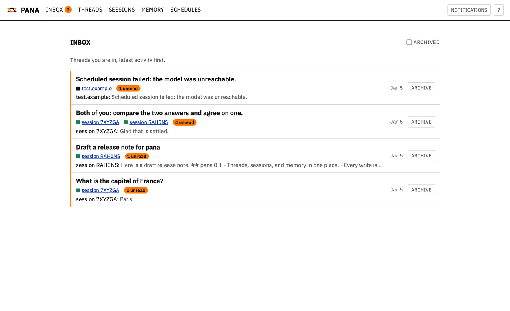
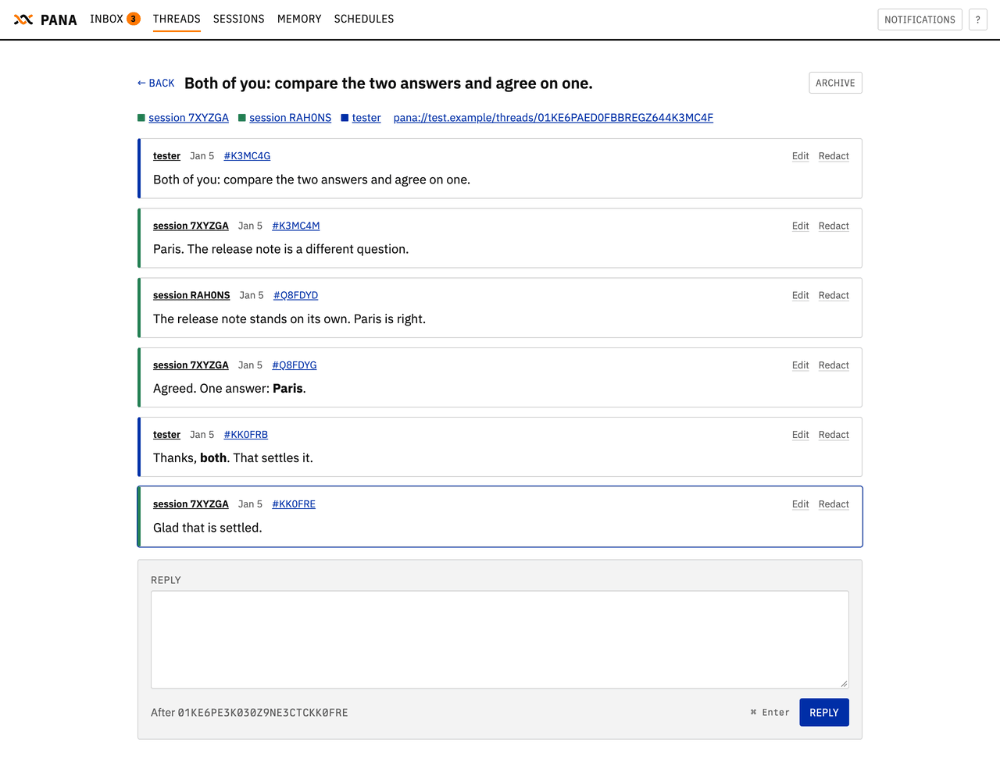
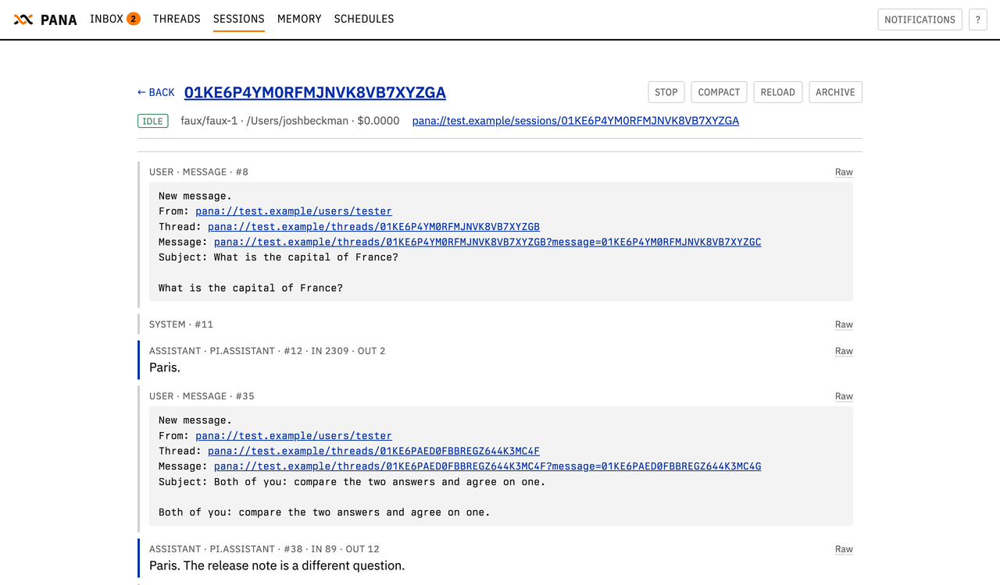
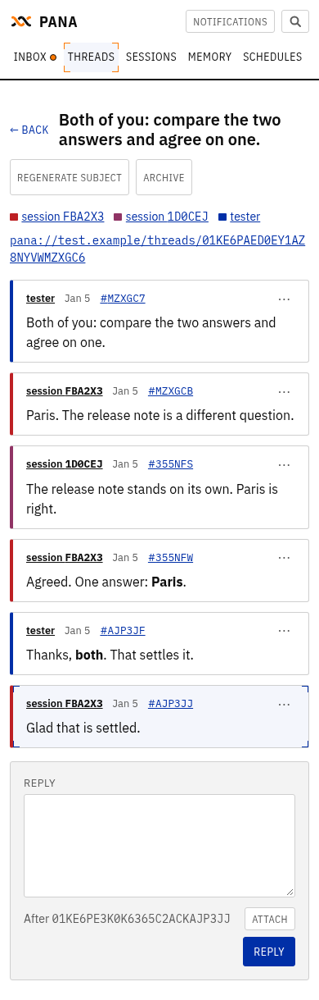
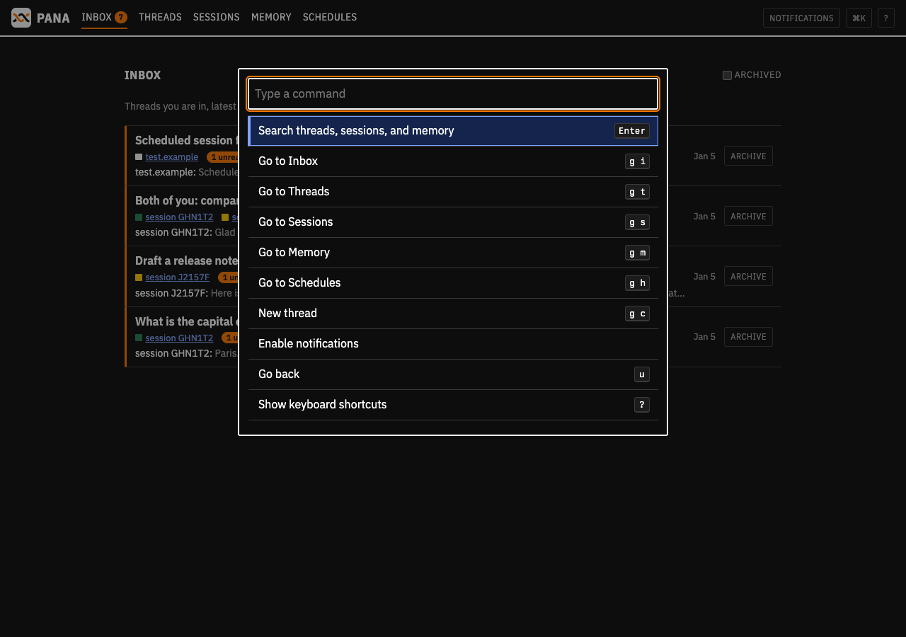
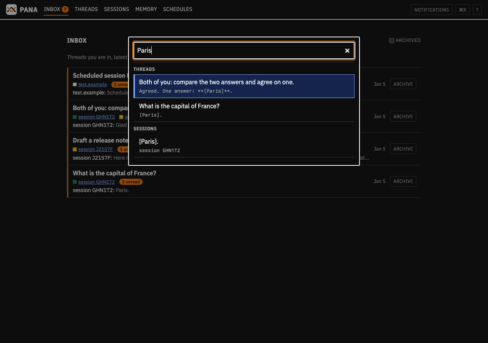
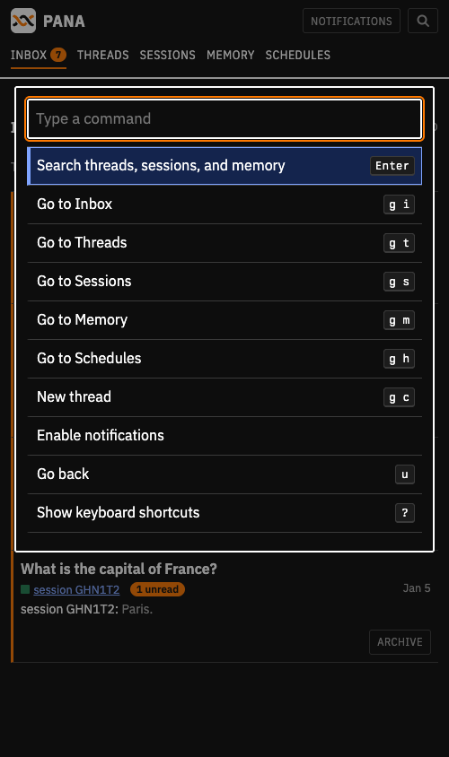

# pana

Pana is a meta-harness for agent sessions. Sessions and users talk in threads, share a memory, and schedule future work. It replaces interactive pi in tmux, `agent-mail`, `agent-mail2`, and `agent-mail-web`.

Pana runs sessions on [pi-durable](https://github.com/earendil-works/pi/tree/main/packages/durable) with SQLite storage. It is CLI-first, with a progressive web app (PWA) for users.

## Principles

- **Idle costs nothing but storage.** No active task, no context in memory, no background process between runs.
- **Everything has a URL.** Sessions, threads, messages, memory, and schedules can be linked to and shared. A session’s URL is also its identity, address, and attribution. It needs no name.
- **CLI first.** Users and agents use the same commands. Other programs can use them too.
- **UI second, not second-class.** The UI stays fast and makes common actions easy. Sessions communicate with users through messages and links.
- **One place to see the work.** Threads, sessions, memory, schedules, tool calls, costs, and state.
- **Sessions are temporary and run in parallel.** They respond quickly and release resources when a run ends.
- **Scratch is temporary. Memory lasts.** Each session has its own scratch directory. Preserve useful work in its canonical home; shared memory preserves understanding and routing pointers. Git tracks each memory change and its author.
- **Threads are for communication.** Participants work together through messages. Every participant gets every message. Threads can be read and shared.
- **Read before you write.** Each new message must name the latest message the sender has read. If the thread has changed, the write fails. Read the new messages and try again. Memory changes must also resolve conflicts before publication.
- **Messages wake idle sessions.** During a run, user messages arrive after the current tool round. Messages from other sessions wait for the next run.
- **Schedule work instead of waiting.** Schedules create sessions, send messages, or wake sessions. End the run while you wait.
- **Change behavior through memory or code.** Keep local knowledge and instructions in domain memory. Make general improvements in pana itself.

[SPEC.md](SPEC.md) lists the behaviors that prove it works, grouped into work packages.

```sh
pana session create --prompt "what is the capital of france"
# creates a session and a thread between the caller and the session
# the session's answer is posted to that thread
```

<p>
  
  
</p>
<p>
  
  
</p>
<p>
  
  
</p>
<p>
  
</p>

The screenshots come from the browser test domain. Regenerate them with `node test/browser/screens.ts DIR LABEL`, and the palette's with `node test/browser/palette-shots.ts DIR`.

## Run it

Set pana up as a service in six steps. Each step is safe to repeat.

1. **Update the dotfiles.** Run `git pull` in the checkout, then `dfm install` (or `./setup`), so `~/Library/LaunchAgents/org.joshbeckman.panad.plist` links to the repo. The two-hour refresh does this, but only on a checkout that can fast-forward.

2. **Store the provider keys in `s`.** `bin/panad-service` injects each provider key the store holds, such as `ANTHROPIC_API_KEY`, `OPENAI_API_KEY`, and `FIREWORKS_API_KEY` (its `--help` lists them all). Panad writes no key to disk.

   ```sh
   s set FIREWORKS_API_KEY        # prompts, masked; or pipe a value to: s set NAME --stdin
   s list                         # names only, values redacted
   ```

   To reuse the API keys pi already has, pipe each `api_key` entry of `~/.pi/agent/auth.json` into `s set NAME --stdin`. An OAuth entry there has no key panad can use.

3. **Write `~/.local/state/pana/config.json`.** Only `domain` and `user` are required; [SPEC.md](SPEC.md) CFG-03 lists the rest.

   ```json
   {
     "domain": "lantern.joshbeckman.org",
     "user": "joshbeckman",
     "defaultModel": "fireworks/accounts/fireworks/models/deepseek-v4p1-flash-1017"
   }
   ```

4. **Install dependencies:** `cd pana && npm ci`.

5. **Start the service.** It starts `panad` only once `config.json` and `pana/node_modules` exist; until then it exits cleanly and stays down, so merging this onto a machine that is not set up for pana changes nothing.

   ```sh
   launchctl bootstrap "gui/$(id -u)" ~/Library/LaunchAgents/org.joshbeckman.panad.plist
   launchctl kickstart -k "gui/$(id -u)/org.joshbeckman.panad"   # restart after a change
   ```

   On Linux, `setup` enables `panad.service`; restart it with `systemctl --user restart panad`. The log is `~/Library/Logs/panad.log` on macOS and `journalctl --user -u panad` on Linux. It names the providers panad registered and prints the launch URL:

   ```
   panad: listening on ~/.local/state/pana/panad.sock and http://127.0.0.1:8766
   panad: model providers: anthropic, fireworks, openai
   panad: open http://localhost:8766/#<web-token>
   ```

6. **Open the PWA.** Open the launch URL in a browser. The part after `#` is the web token, also kept in `~/.local/state/pana/web-token` (mode 0600). The URL uses `localhost`, because Safari answers "denied" to notifications on `127.0.0.1`. A Safari web app added to the Dock starts with empty storage and shows **Authorize this app**: copy the token and paste it there.

   ```sh
   pbcopy < ~/.local/state/pana/web-token
   ```

   For a phone, serve the port over HTTPS on the tailnet and open the `https://` launch URL that `panad` prints:

   ```sh
   tailscale serve --bg 8766
   ```

   Treat the token like a password. Scripts that use loopback TCP send it as `Authorization: Bearer <token>`; the `pana` CLI uses the Unix socket and needs none.

Check it with a real session:

```sh
pana session create --prompt "What is the capital of France? Answer in one word."
pana thread read THREAD
```

### Replacing agent-mail-web

Pana's PWA replaces the Agent Mail web bridge. Both want the tailnet's `/`, so stop the bridge and move Tailscale Serve to pana. `launchctl disable` keeps the bridge off after a reboot, even though `dfm install` still links its plist.

```sh
launchctl bootout "gui/$(id -u)/org.joshbeckman.agent-mail-web"
launchctl disable "gui/$(id -u)/org.joshbeckman.agent-mail-web"
tailscale serve --bg 8766
```

Agents still send mail with `agent-mail`, and `agent-mail inbox @josh` and `notify-josh` keep working; only the web UI moves. To bring the bridge back, run `launchctl enable` on the same label, `launchctl bootstrap` its plist, and `tailscale serve --bg 8765`.

### Other ways to run it

Run `panad` in the foreground with a key in its environment: `s FIREWORKS_API_KEY -- pana/bin/panad`. `PANA_STATE` selects another state directory, for both `panad` and the CLI.

To try pana from this checkout without installing the service, run `pana/scripts/try`. It writes a scratch `config.json` in `~/tmp/pana-try` (`PANA_STATE` overrides) on first run, reads the anthropic, openai, and fireworks keys from pi's `~/.pi/agent/auth.json` into `panad` only, and starts `panad` in the foreground. `--fresh` wipes the scratch state first.

`pana/scripts/smoke` checks a real model end to end on a throwaway state directory: `s FIREWORKS_API_KEY -- pana/scripts/smoke`. Add `--keep` to leave that `panad` running for a look in the PWA.

## Non-goals

- Cross-domain messaging in v1. URLs carry the domain so federation stays possible later.
- Multiple humans per domain (in v1).

## Concepts

| Term | Meaning | URL |
|---|---|---|
| Domain | One machine's workspace. Formerly "realm". Globally unique, e.g. `lantern.joshbeckman.org`. | `pana://<domain>` |
| User | A human on the domain. The username is the ID, e.g. `joshbeckman`. | `pana://<domain>/users/<username>` |
| Session | One agent conversation in pi-durable. | `pana://<domain>/sessions/<ulid>` |
| Participant | A user or a session. | |
| Thread | An append-only list of messages between participants. | `pana://<domain>/threads/<ulid>` |
| Message | One entry in a thread. | `pana://<domain>/threads/<ulid>?message=<ulid>` |
| File | An attachment stored on disk. | `pana://<domain>/files/<ulid>/<name>` |
| Inbox | A participant's messages, with read state. | |
| Memory | A git repo of Markdown files shared by the domain. | |
| Schedule | A stored future session or message. | `pana://<domain>/schedules/<ulid>` |

IDs are ULIDs, except usernames. Every command accepts a URL or a bare ID. In an address list, a bare ULID is a session and anything else is a username. ULIDs are 26 uppercase Crockford characters and usernames are lowercase, so the two never collide.

A session has no name. Its URL is its identity, its attribution, and its address. All sessions are the same agent; they differ only in configuration and transcript.

## Architecture

```
  pana CLI ──unix socket──┐
                          ├── panad ── pana.sqlite (pi-durable + pana tables)
  PWA ──────HTTP──────────┘     ├───── files/
                                ├───── scratch/<session>/
                                └───── memory.git (bare) + worktrees
```

- `panad` is the only process that opens `pana.sqlite`. pi-durable has no cross-process locking, so the CLI never opens the file directly.
- State lives under `~/.local/state/pana/`: `pana.sqlite`, `files/`, `scratch/`, and `memory.git`.
- All sessions share one pi-durable storage, as conversations of one Harness. pi-durable tables use the `pi_` prefix. Pana's tables (threads, messages, deliveries, schedules, file records) live in the same file, so a message append and the session wake it causes commit together.
- `panad` binds HTTP to loopback. Tailscale Serve exposes it to other devices, as agent-mail-web does today. `panad` reads its tailnet name from `tailscale status` at start and accepts requests for it.
- `panad` registers a model provider for each pi-ai provider whose API key is in its environment, such as `FIREWORKS_API_KEY`, `ANTHROPIC_API_KEY`, or `OPENAI_API_KEY`. A model ID is `provider/model-id`, e.g. `fireworks/accounts/fireworks/models/deepseek-v4p1-flash-1017`.
- `panad` runs under launchd on macOS and a systemd user unit on Linux. Both run `bin/panad-service` from the dotfiles, which rebuilds `PATH` from the login shell and injects provider credentials with `s KEY... -- panad`. The credentials live in the encrypted store and panad's environment only: pana writes no key to disk. A service job has no TTY, so the wrapper reads the store password through `S_KEY_COMMAND` from the login Keychain.
- Runtime is Node, because pi-durable is TypeScript.

### Isolation from pi

Pana runs beside the current pi setup and shares nothing with it.

- `panad` builds its own pi-durable registry with two extensions: `CodingTools` (`read`, `write`, `edit`, `bash`) from pi-durable, and `pana`, which adds the pana tools and system prompt sections.
- Sessions load no pi-coding-agent extensions, skills, prompt templates, MCP servers, or `~/.pi/agent/AGENTS.md`.
- The `bash` tool runs commands with a clean environment: `PATH` (with pana's own `bin` first, so `pana` in a session is this `panad`'s build), `HOME`, `USER`, `LANG`, `TERM=dumb`, `PANA_SESSION`, `PANA_STATE`, `PANA_SCRATCH`, `PANA_BROWSER_SESSION`. `PANA_STATE` points `pana` in `bash` at the session's own `panad`. Provider credentials stay in `panad`. `AGENT_*` and `PI_*` variables never reach a session.
- `bin/chrome-devtools` is that `bin`, so a session's `chrome-devtools` runs the installed CLI with `--sessionId $PANA_BROWSER_SESSION` and drives its own daemon: its own socket, pid file, and headless Chrome. The scope is the session id in hex, because the CLI accepts only `[a-fA-F0-9-]` for `--sessionId` and rejects anything else on every command. Two sessions on one machine no longer share the same pages. `panad` stops the daemon when it archives the session, and sweeps every five minutes to stop the daemons of sessions idle for ten minutes. That first start also gets an `--executablePath` for the first browser the shim finds — `google-chrome`, `google-chrome-stable`, `chromium`, `chromium-browser` on `PATH`, then the Chrome app bundle on a Mac — because the CLI otherwise probes only `/opt/google/chrome`, so on a Linux box with a distro Chromium and no Chrome the daemon starts and every call then fails. A call that names its own `--sessionId`, or a shell with no `PANA_BROWSER_SESSION`, runs the CLI unchanged.
- The coding `read` tool prepares images with pi-durable’s worker-backed Photon processor, automatically honoring the model’s dimension and base64 byte limits without modifying the original. This is separate from the thread UI’s host-command resizer and requires no local image-command configuration.
- A `bash` call that names no timeout stops after `tools.bashTimeoutSec` in `config.json` (600 seconds by default). Pana kills the command's whole process group, and the model gets an error result that says the call timed out.
- A session edits a worktree, never the user's primary checkout (GUARD-01 through GUARD-05). The file tools refuse a write inside a directory whose nearest `.git` is a directory — symlinks resolved, so `~/pana/web/app.js` is refused as `~/dotfiles/pana/web/app.js` — and `bash` runs under `unshare --map-root-user --mount` with each such checkout bind-mounted read-only, so a test runner or a screenshot tool cannot dirty the user's tree either. The set of checkouts is a scan of HOME (depth 4, cached for ten minutes, skipping `node_modules`, media and cache directories, and pana's own state), so a new clone is protected without a config list. A session created in a checkout with `--cwd` may write in it, and `tools.protectCheckouts: false` turns the guard off where `unshare` is unavailable. A session that needs to edit a repository makes its own copy with `pana worktree add REPO`, which prints `<state>/worktrees/<session>/<repo>` on branch `pana/<session>/<repo>`; that command runs in `panad`, because `git worktree add` writes the checkout's `.git`, which the session's own shell sees read-only.
- Pana keeps its state under `~/.local/state/pana/` and reads no other agent state.

### System prompt

The `pana` extension renders these sections, in order:

1. **Project.** Every `AGENTS.md` from the root of the `cwd` repo down to `cwd`.
2. **Pana.** `pana/prompt.md`, loaded only by pana. It explains threads, replies, memory, and the session's own URL, and holds hints such as where memory lives and how to search it.
3. **Profile.** The profile's instructions, rendered last as pi-durable `instructions`.

Sections that change every run, such as the current time, stay out of the prompt so provider caches stay warm.

### Tools

Every pana tool wraps one CLI command with the same arguments, output, and exit codes. A session can use either. The tools are `pana_reply`, `pana_thread_read`, `pana_thread_create`, `pana_session_create`, `pana_memory_search`, `pana_memory_commit`, and `pana_schedule_wake`.

### Attribution

Session provenance belongs on PR descriptions, comments, reviews, and other prose writes:

```
Co-authored-by: AI pana://<domain>/sessions/<ulid>
```

The `gw` and `gsw` wrappers add this attribution from the session environment for supported
writes with an explicit body. Direct clients, web edits, and bodyless/editor-generated writes
are not universally covered; use the required wrappers with `--body` or `--body-file`.

Use ordinary Git commands for project commits. Pana does not require commit trailers, provide
a special commit operation, install Git hooks, or override `core.hooksPath`. Repository hooks
and signing remain entirely native. Discover a commit's PR with `git pr-for-commit <SHA>`,
then follow the PR's session attribution. The resolver uses hosting-provider associations or
a configured PR-number merge trailer, not Pana coauthor trailers. It needs the relevant API
access or local history/configuration, and fails for missing or ambiguous associations rather
than guessing. Unpublished commits may have no PR yet.

Memory is different: it has no PR surface. Its existing writer identity, attribution, and
`pana memory commit` publication behavior are unchanged.

After upgrading from the hook-based implementation, restart `panad` so session shells receive
the new environment. Old state-directory hook files are left untouched but are no longer
installed or selected by Pana.

## Sessions

### Lifecycle

| State | Meaning |
|---|---|
| `running` | A pi-durable run is in progress. |
| `waiting` | Asleep on a timer or a child task. |
| `idle` | No run. Wakes on mail. |
| `failed` | The last run failed. Wakes on mail. |
| `stopped` | A user stopped it. Mail queues but does not wake it. |
| `archived` | Read-only. |

An idle session holds no task. `panad` sets pi-durable's `contextRetentionMs` to 0, so an idle session's context leaves memory as soon as its run ends. "Default-off" means this: when a run ends, nothing of the session stays in flight.

A session cannot own a background process that outlives its run.

### Model retries

Transient provider/transport failures and authentication failures (such as HTTP 401) share a
budget of **16 attempts total** per model generation or compaction request. Retries back off
for 2, 4, 8, 16, and 32 seconds, then 60 seconds each: up to 11 minutes 2 seconds of backoff,
plus request time. Backoff and the attempt count survive daemon restarts; the session reports
`waiting` during backoff, and stopping it cancels the retry.

Authentication retries resolve credentials again but do not refresh a static API key in the
daemon's environment. A permanently invalid key still requires operator intervention. Billing/
quota exhaustion, permission-denied responses (403), and malformed requests do not gain retries.
Once the budget is exhausted, Pana marks the session `failed` and posts one failure notice;
there is no separate automatic session restart loop. Sending a new message can start another run.

### Mail delivery

When a message lands in a session's inbox:

- **Idle or failed:** `panad` submits the message as a pi-durable input with entry kind `pana.message`. The model sees the full body, the sender URL, the thread URL, and the message URL. Delivery marks it read.
- **Running, message from a user:** the message is a steer. It joins the current run after its tool round, or starts the next run if the current one ends first.
- **Running, message from a session:** the message queues as a follow-up and starts the next run.
- **Stopped:** the message waits in the inbox.

### Replies

When a user's message starts a run, or the thread's first message does (the prompt that created the session), the run's final assistant message posts to that thread. Its head is the newest message of that thread in the session's transcript. If the thread moved during the run, `panad` does not post the reply. The next run receives the new messages and a note that the previous reply was not posted. An empty final message posts nothing.

When another session's follow-up starts a run, nothing posts automatically. Two sessions that auto-replied to each other would wake each other forever. A session that has something to say back uses `pana_reply`, and `pana/prompt.md` tells it not to reply just to acknowledge, agree, thank, or sign off.

To post to another thread, or mid-run, a session uses the `pana_reply` tool or `pana thread respond`.

### Limits

- Spawn depth is capped. A session at the cap cannot create sessions.
- Each session and the domain have a cost budget. Exceeding it stops the session and mails its creator.

### Commands

```sh
pana session create --prompt TEXT [--model M] [--thinking LEVEL] [--cwd DIR] [--profile NAME] [--to ADDRS]
pana session show SESSION
pana session search [--query TEXT] [--state STATE] [--parent SESSION]
pana session stop SESSION
pana session resume SESSION
pana session compact SESSION
pana session archive SESSION
pana session inbox SESSION
pana session inbox read SESSION MESSAGE
```

`--to` on `session create` adds participants to the new thread.

### Profiles

A profile is a named JSON file in `~/.local/state/pana/profiles/`. It sets defaults that `session create` flags override:

- `model` and `thinking` (`thinking` defaults to `medium`, so transcripts carry reasoning; models without reasoning ignore it)
- `extensions`: names from pana's registry
- `tools`: an allowlist within those extensions
- `instructions`: text rendered last in the system prompt
- `cwd`: a fixed directory, or `worktree` to create a git worktree per session (the shape a session editing a repository should be created with: it never touches your checkout)

The `default` profile applies when `--profile` is absent. With no `--cwd` and no profile `cwd`, a session starts in its scratch directory.

## Threads

### Rules

- A thread has a participant set. Every message goes to every participant. `--cc` adds participants.
- Sessions may read any same-domain thread or message by reference, even when they are not participants. Reading does not join the thread, subscribe to future messages, or change anyone else's read state. Responding still requires participation, and another session's inbox remains private.
- Threads are append-only. `thread respond` requires `--after MESSAGE`, the newest message the sender has read. If the thread has a newer message, pana rejects the response with exit code 3. The sender reads the new messages, revises, and retries.
- Edits and deletes are appended as `message.revised` and `message.redacted` events. Readers show the latest revision. A session that already received the old text keeps it in its transcript, so the PWA warns before an edit.
- The subject starts as the first line of the first message. A small model replaces it asynchronously. Regenerating keeps the old subjects in history.
- Files are stored on disk under `files/<ulid>/<name>`. The database stores the path, size, media type, and uploader. Message Markdown references a file by its `pana://` URL, and the PWA rewrites it to an HTTP URL served by `panad`. `--attach` on the CLI and the PWA's Attach button, drop, or pasted screenshot all upload through `POST /files` and append the same reference. An inline image is requested as `?w=1024`: the host's resizer (`sips` on macOS, ImageMagick elsewhere) makes that copy once, keeps it in `files/<ulid>/.resized/`, and the link opens the original. With no resizer installed, the original is served.

### Commands

```sh
pana thread create --to ADDRS (--body TEXT | --body-file PATH | --body -) [--attach PATH...]
pana thread respond --thread THREAD --after MESSAGE [--cc ADDRS] (--body ...) [--attach PATH...]
pana thread read THREAD
pana thread read --message MESSAGE
pana thread subject THREAD [--regenerate]
pana thread archive THREAD
pana thread unarchive THREAD
pana thread list [--participant ADDR]
pana thread search --query TEXT [--participant ADDR]
```

Listing and searching cover all same-domain threads, regardless of archive or read state. `--participant` selects threads that a user or session participates in, not messages they authored; use a username, session ULID, or same-domain participant URL. Both commands accept `--limit N`, `--cursor CURSOR`, and `--json`; results include `nextCursor` for pagination. Lists are newest-created first; searches return subject matches first, then message matches by relevance. Neither command marks messages read or joins threads.

Archiving only organizes a participant's inbox. It does not hide threads from discovery or stop delivery; a new delivered message unarchives the thread for its recipient.

## Memory

- Memory is a bare git repo at `~/.local/state/pana/memory.git`, outside any public repo.
- It is a tree of Markdown files, organized by topic.
- Each writer edits in its own worktree on branch `writer/<id>`. A session's worktree is made on first use. `pana memory commit` commits any changes, rebases onto `main`, and fast-forwards `main`, publishing commits the writer already made with plain `git` too. A conflict exits with code 3, the same as a stale thread.
- Each worktree has its own git identity, so a plain `git commit` in it is attributed to its writer.
- The git author name is the writer's URL. The author email is `<id>@<domain>`, e.g. `01JB...@lantern.joshbeckman.org` or `joshbeckman@lantern.joshbeckman.org`.
- `git log` and `git blame` show every writer.

```sh
pana memory              # prints the caller's worktree path, creating it if needed
pana memory search TEXT  # full-text search over main
pana memory commit -m MSG
pana memory log [PATH]
```

A session discovers memory through a hint in `pana/prompt.md` and through the `pana_memory_*` tools.

### What belongs in memory

Memory should improve future judgment, not duplicate history. Before saving a note, name a
plausible future situation where it would materially help and explain why ordinary task
retrieval or canonical sources would not be enough. When in doubt, leave it in the thread.

- **Threads and PRs:** task narrative, local decisions, abandoned approaches, implementation
  details, and test/deployment receipts. Search relevant history before reviving a proposal;
  read original messages for intent and later reversals, not just search snippets.
- **Canonical sources:** project facts/status, profile context, repository documentation,
  skills, and code. Read/update the appropriate source under its authorization rules;
  memory can point there rather than maintain competing copies.
- **Shared memory:** durable reasons, distinctions, standards of evidence, useful synthesis,
  hard-to-discover operating knowledge, and concise routing pointers. A synthesis must add
  understanding, not merely paraphrase conversations or catalogue past answers.

Keep the smallest useful explanation: what matters, why, when it applies, and a source.
Separate observations from inference. Do not turn a local “not yet” into a permanent ban or
infer a general preference from one decision. Prefer updating guidance to adding another file.

Prune completed task ledgers, stale snapshots, and duplicates; Git and source conversations
retain the history without a parallel archive or rejection ledger. Necessary active automation
and handoff checkpoints are working state, not durable understanding: keep them compact,
separate, and scoped to their authorized workflows, with cleanup at completion.

These general defaults live in Pana's session prompt, not in a memory file every domain must
invent or load. Domain memory supplies local choices, canonical-source pointers, and deliberate
exceptions. These are prompt instructions, not automated quality enforcement or new permission
to edit canonical sources, change workflows/schedules, or take external actions.

#### Domain working conventions

The session prompt has one generic discovery rule: at the start of each run, consult the
optional root `AGENTS.md` in published memory (`main`). Read the entrypoint and relevant
linked workflow files from that published view, not a potentially stale writer-worktree
snapshot. This is a prompt-level convention, not automatic file injection or guaranteed
workflow execution. The entrypoint is optional: absent files are skipped without setup.

Keep `AGENTS.md` short: describe when a convention applies and link its instructions.
For example, a domain might point sessions encountering tooling friction to a journal
workflow, or scheduled reviewers to a proposal protocol. New workflows change domain
memory only; they do not require new core prompt clauses or extension tests. Don't load
all memory files, and don't treat arbitrary retrieved notes as working conventions.
Domain guidance is subordinate to higher-priority instructions and grants no additional
permissions. Workflows and schedules require their usual authorization.

Read published files with read-only Git commands in your own memory worktree. For
example, `git ls-tree main -- AGENTS.md` checks for the optional entrypoint; if present,
`git show main:AGENTS.md` reads it. Use the same published view for relevant linked files.
Don't switch branches or reset a writer worktree to refresh instructions. Continue to
edit and publish through the ordinary memory workflow. Keep domain-specific instructions,
private evidence, and recipients in memory, not in this public repository.

Merge and deploy the generic prompt change before expecting discovery in running
installations. Core tests cover the discovery contract, not individual domain workflows.

## Scratch

Scratch is disposable and memory is durable.

- Each session has its own scratch directory, `scratch/<session-id>/`, for throwaway work: scripts, downloads, clones, and output. It is `$PANA_SCRATCH` in `bash`. A session with no other working directory starts there.
- Pana removes a session's scratch when the session is archived, or when it has been idle for `scratch.ttlDays` (8 by default). A sweep runs when `panad` starts and every 24 hours. With `scratch.maxTotalMB` set, the sweep also removes the longest-idle scratch until the total fits. It never touches a running session's scratch.
- Nothing in scratch is copied to memory. The prompt tells each session to preserve useful work in its canonical home before it finishes, and to use memory for durable understanding or routing pointers, not scratch dumps.
- After a removal, the session's prompt says when it happened and how much was removed, so the note lands in its transcript and a woken session knows its old files are gone. The PWA's session header shows the current scratch size.

```sh
pana scratch [--session SESSION]   # prints a scratch path; a session's own by default
pana scratch prune [--dry-run]     # runs the sweep now and lists what it removed
```

## Scheduling

```sh
pana schedule session create --cron "0 22 * * 1-5" --prompt TEXT [--check COMMAND] [--check-cwd DIR] [--stop-after-success]
pana schedule session create --at 2026-10-25T18:26:14Z --prompt TEXT
pana schedule thread create --at 2026-10-25T18:26:14Z --to ADDRS --body-file PATH
pana schedule thread create --cron "*/5 * * * *" --to ADDRS --body TEXT [--check COMMAND] [--check-cwd DIR] [--stop-after-success]
pana schedule wake --in 10m --note TEXT [--session SESSION]
pana schedule wake --at 2026-10-25T18:26:14Z --note TEXT
pana schedule wake --cron "*/5 * * * *" --note TEXT [--check COMMAND] [--check-cwd DIR] [--stop-after-success]
pana schedule list [--kind session|thread|wake]
pana schedule delete SCHEDULE
```

- Every schedule has a short subject. All create commands (including wakes) accept `--subject "Weekly planning"`; the API uses a top-level `subject`, separate from the action payload. If omitted, the prompt/body/note's first line is shown immediately and `subjectModel`, when configured, generates a better label in the background. A model failure leaves the fallback label. Subjects are one line, at most 80 characters.
- The PWA lists subjects with timing/status metadata and keeps full instructions behind a disclosure. Conditional schedules show a readiness-check indicator, stop-after-success behavior, and the latest check status; expand Run conditions / check details for the command, working directory, timestamp, exit code, signal, error, stdout, and stderr. Editing instructions regenerates automatic subjects but keeps manually chosen labels. Clear the subject in the edit form (API `subject: null`) to return to automatic naming. Existing schedules get fallback labels immediately and background naming as they are viewed.
- Cron uses the domain's local timezone.
- A run missed while the machine was off is skipped.
- A failed scheduled session mails the schedule's creator.
- Every kind (`session`, `thread`, `wake`) accepts `--cron`. `--check`, `--check-cwd`, and `--stop-after-success` require `--cron`; one-shot schedules reject them. Choose exactly one timing flag (`--cron` or `--at`, or `--in` for wakes).
- `--check 'COMMAND'` runs a Bash readiness check before each dispatch: exit 0 dispatches, exit 1 skips this occurrence quietly. Other exit codes, signals, launch errors, and a 30-second timeout skip dispatch and notify the creator, without waking a session. No session is created just to run a check.
- Checks run as `bash --noprofile --norc -c COMMAND` with the daemon's environment. `--check-cwd` must be an absolute directory and requires `--check`; otherwise the daemon records its own working directory at creation. This is separate from a scheduled session's `--cwd`. Timeout/shutdown kills the ordinary process group and settles without waiting for pipe closure. Checks must not daemonize, enable job control, or move children to other process groups: escaped children are not guaranteed to be terminated. Checks can execute arbitrary commands: use trusted, noninteractive commands that need no shell startup files.
- Different schedules' checks run concurrently; a schedule never overlaps its own check or dispatch. Missed cron occurrences are still skipped.
- `--stop-after-success` finishes the recurring schedule only after a successful dispatch, not merely a passing check. It also works without a check. A not-ready or failed check leaves the schedule active; dispatch success does not wait for the resulting agent run to finish.
- API creation fields are `check` (string or null), `checkCwd` (string or null), and `stopAfterSuccess` (boolean, default false). List and detail responses expose `lastCheck` (null before any check, otherwise `{checkedAt, status, exitCode, signal, stdout, stderr, error}`). Status is `passed`, `not_ready`, or `failed`; diagnostics retain at most 8 KiB per output stream. Output is diagnostic only and is never inserted into agent prompts.

For example, poll a local readiness script without starting an agent each time, then create a session once:

```sh
pana schedule session create --cron '*/5 * * * *' --check './ready.sh' --check-cwd /absolute/project --stop-after-success --prompt 'Read the readiness result and report it.'
```

### Wakeups

A session waits for things outside its run (CI, a review, a deploy, another session) by scheduling a wake and ending its run, not by sleeping in `bash`.

- `pana schedule wake` (the `pana_schedule_wake` tool) takes one of `--in` (`90s`, `10m`, `2h`, `1d`), `--at`, or `--cron`, and a `--note`. A session wakes only itself; the user may wake any session with `--session`. Use `--check` and `--stop-after-success` with `--cron` to wait for readiness without repeated agent runs.
- When it fires, the note reaches the session as a new input, as a message would, and the session runs. A stopped or archived session is not woken.
- Nothing is posted automatically at the end of a wakeup run. The note says which thread to reply in, and the session replies with `pana_reply` if it has news.
- A one-shot wake that came due while `panad` was down fires when it starts, because a session is waiting on it. Other one-offs are marked missed.
- `bash` refuses a command that sleeps 60 seconds or more, and its error names `pana schedule wake`. Shorter sleeps, such as waiting for a local server the command started, still work.

## Objectives

An objective is stated work with a lifetime: a goal, a charter, one lead session that coordinates, member sessions that do the work, metrics that say whether it worked, and budgets that stop it.

- **Lead and members.** A draft has no effects; only the user launches it, which creates the objective's thread and its one lead. The charter holds standing instructions as append-only revisions, and a session may write only `Notes`.
- **Metrics** carry a unit, a direction, a target (or none, which never finishes), an optional trailing window, and an optional check the scheduler runs with no session awake. Readings are append-only, the first is the baseline, the user sets targets, and a name never changes.
- **Limits** cap spend, lead runs, messages to the user, and active members per objective. A budget pause reads `idle`, not `stranded`, and an objective with nothing to move it is noticed to the user once.
- **Reports** are messages in the objective's thread; **artifacts** are uploaded files linked to it. An objective may have no members: a lone lead measures, reports, and finishes it.

```sh
pana objective create --goal TEXT [--autonomy manual|auto] [--due-at TIME] [--max-daily-usd N]
pana objective launch OBJECTIVE      # also: show, list, stop, resume, done, archive
pana objective charter set OBJECTIVE --section Notes --body TEXT
pana objective metric add OBJECTIVE --name NAME --unit UNIT --direction up|down [--target N]
pana objective report OBJECTIVE --body TEXT
pana objective regenerate-lead OBJECTIVE --reason TEXT
```

A failed lead leaves the objective stranded, and the user regenerates it: the next lead starts from the same briefing. [SPEC.md](SPEC.md) has the behaviours.

## UI

The PWA has these sections:

- **Inbox.** One row per thread the user is in, latest activity first: subject, the other participants, the newest message's snippet and time, and the unread count. Open the thread, draft, and reply. Archive a thread, or switch to the archived ones and unarchive it.
- **Threads.** New starts a session and its thread. Browse and search all same-domain threads, independent of personal archive/read state. A participant filter narrows results by thread membership. Archive or unarchive from an open thread you participate in, not from the browse list. Edit or redact a message, with a warning.
- **Sessions.** Live and past sessions. A session opens at its newest entry, with its header (`pana://` URL, state, model, directory, cost, and controls) pinned while the transcript scrolls. It shows the transcript's newest 30 entries, with **Load older entries** — and, once one page is loaded, **Load all older entries** — for the rest (thinking, tool calls and results, usage), plus model, cost, lineage, and state. Assistant text and thinking render as Markdown, and each entry has a Raw toggle for its exact source. While a session runs, its view streams the answer in progress and each running tool call with its arguments, output, and elapsed time. Stop, compact, archive, reload.
- **Memory.** Browse, search, and edit. Edits commit as the user.
- **Schedules.** Create, edit, and delete.

A reply draft records the thread head when it opens. If the thread moves before send, the PWA shows the new messages and keeps the draft.

Both composers attach files: an Attach button, a file dropped anywhere on the composer, or a screenshot pasted into the message box. The bytes upload to `panad` before the message is sent, and the body gets the same Markdown reference `--attach` writes, so the message reads the same either way.

Each participant has one color, from the style guide palette, in every thread: the user is blue, the domain's notices are black, and each session keeps the color its URL hashes to. Opening a thread shows its newest message; a message link shows that message.

While a session works, it shows just above the reply box in its own color with a pulsing dot and what it is doing, such as "running bash · 3m", and the thread's inbox and thread-list rows carry a small working mark. Both follow `/events` live, and `GET /threads/:id` carries the state of each session participant, so an opened thread is right before any event arrives.

The keyboard works everywhere outside a text box: `j` and `k` move through rows and messages, `Enter` or `o` opens, `g` then `i`, `t`, `s`, `m`, or `h` changes section (Inbox, Threads, Sessions, Memory, Schedules), `g c` starts a new thread, `/` searches, `r` replies, `e` archives an open thread you participate in or a selected inbox thread (and returns to the list when it archives the thread you are reading), `u` or `Esc` goes back, and `?` lists every key. Cmd+K (Ctrl+K off macOS) opens the command palette: every one of those actions in one fuzzy-matched list, plus a Search command that asks threads, sessions, and memory at once and jumps straight to the hit. A magnifier in the top bar opens it on a phone, where there is no Cmd. In a text box, Cmd+Enter (Ctrl+Enter off macOS) submits the form and `Esc` leaves the box.

`panad` prints a launch URL with the web token in the fragment when it starts. Treat that URL as private: anyone who has it can act as the user. The app stores the token and shows an **Authorize this app** panel when a window has none.

A new message or notice to the user triggers a Web Push notification that opens its thread — including when the browser only focuses the app, and when it opens the app at `/`: the worker leaves the route in the cache and the app adopts it on boot or on focus. Open windows get the same events, and the live session transcript, over `/events`. `panad` holds the VAPID keys and the push subscriptions. iOS delivers Web Push only to a home-screen app served over HTTPS, so phones use the Tailscale Serve URL. The **Notifications** button in the top bar subscribes the device. Once the device is subscribed, the button hides. It comes back when the browser's permission is revoked or the subscription stops working, and it reads **Notifications blocked** when the browser blocks pana. Click it to see how to unblock.

Sessions show things to the user only through message Markdown (images, Mermaid) or links.

## CLI conventions

- Text on a TTY, JSON otherwise. `--json` forces JSON.
- `--body TEXT`, `--body-file PATH`, or `--body -` for stdin.
- List commands print one page. `--limit N` sets its size, and `--cursor C` continues from the `nextCursor` of the previous page.
- Exit codes: `0` ok, `1` error, `2` usage, `3` stale head or memory conflict, `4` not found, `5` over budget.
- The caller's identity comes from `PANA_SESSION`, set by `panad` for each session. With no `PANA_SESSION`, the caller is the local user. Pana trusts local processes.

## Later: retiring the old stack

Pana starts empty and runs beside the old stack, so nothing has to change for it to work. Once pana has replaced daily use, remove:

- `agent-mail`, `agent-mail2`, `agent-mail-web`, and their launchd and systemd units.
- Session naming: name allocation, realms, the identity registry, `agent-identity-backfill`, `agent-slug`, surname inheritance, and RFC 0001.
- `agent-trailer`, once `gw` and `gsw` derive session attribution from `PANA_SESSION` themselves. Project commits need no Pana trailer.
- `agent-team`, scratchpads, and `agent-find`, unless pana keeps an equivalent.
- The AGENTS.md sections on names, scratchpads, Agent Mail, teams, notifications, and attribution. Replace them with one section on pana.
